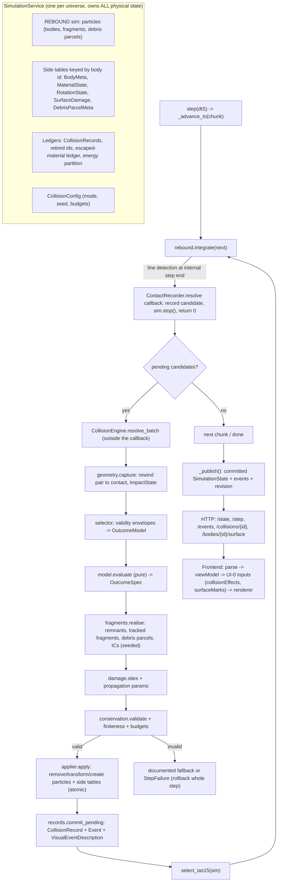
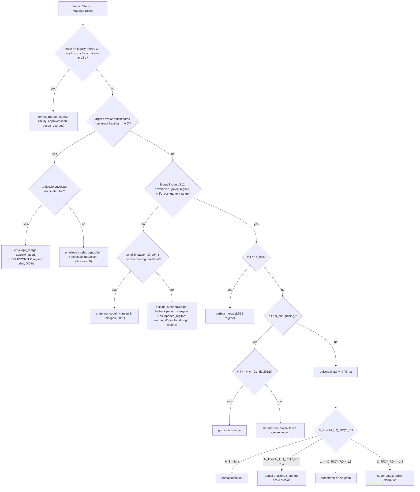

# Collision Engine & Particle Engine — Architecture and Phased Implementation Plan

**Status:** PLANNING ONLY. Nothing in this document is implemented. Every interface, file and field marked **[Proposed]** does not exist yet; everything marked **[Exists]** was verified in the repository at the base commit below.
**Authority:** *Playing God — Collision Engine & Particle Engine — Master Requirements Specification* (18 sections; a verbatim copy is kept at `context/specs/COLLISION_PARTICLE_ENGINE_SPEC.md`). Section numbers `§n` below refer to it. Requirement identifiers (`F1-…`, `M-…`, …) are defined in `COLLISION_REQUIREMENT_TRACEABILITY.md`.
**Companion documents:** `COLLISION_REQUIREMENT_TRACEABILITY.md`, `COLLISION_SCIENTIFIC_MODELS.md`, `COLLISION_RISK_REGISTER.md`, `COLLISION_SONNET_EXECUTION_GUIDE.md` (all in `context/`).
**Planned by:** Claude Opus 5.5, 2026-10-24. **Implemented by:** a separate Claude Sonnet session, one stage at a time, after owner approval of the decisions in section 12.

---

## 0. Planning baseline (verified, not assumed)

| Item | Verified value |
|---|---|
| Base commit | `f2c2da3` (`feature/moons-system`, pushed, clean). It contains all of `main` (`7148556`, 0 commits behind) plus the 10-moon Solar System preset (D-030..D-032). Chosen because the moon-system regression scenarios and Scenario E (fragment strikes a moon) need that preset, and `main` is a strict ancestor. |
| Planning branch / worktree | `planning/collision-particle-engine` at `C:/Aarit/Projects/Playing God collision-particle-planning` (sibling-worktree convention of `Playing God body-render-metadata`). |
| Other worktrees | `C:/Aarit/Projects/Playing God` (`feature/moons-system` `f2c2da3`, clean) and `C:/Aarit/Projects/Playing God body-render-metadata` (`feature/body-render-metadata` `2aa6686`, clean, upstream deleted). Neither was modified. The "12 modified + 2 staged deletions" reported earlier no longer exist: that work was committed as `f2c2da3` and pushed. |
| Backend tests | `python -m pytest -q` in the planning worktree: **567 passed, 1 warning** (Starlette/httpx deprecation), 184.9 s, Python 3.11.7, REBOUND 5.2.2. |
| Frontend | `npm ci` OK; `npm run typecheck` clean; `npx vitest run` **433 passed / 46 files**; `npm run build` OK (existing >500 kB chunk warning). |
| Browser E2E | `npx playwright test`: **7 failed, all with "Executable doesn't exist … run `npx playwright install`"** — the machine has no Playwright browser binaries. Environment gap, not a code failure; CI (`.github/workflows/ci.yml`) installs Chromium itself. Not installed during planning (download needs owner approval). |
| Python packages | No `numpy`, no `scipy` in the project venv (`backend/requirements.txt`: fastapi, uvicorn, rebound 5.2.x, pytest, httpx). |

### 0.1 Probes run during planning (scratchpad only, not committed)
`probe_rebound.py`, `probe2.py` (session scratchpad) exercised REBOUND 5.2.2 through the real `SimulationService`:

| # | Question | Observed |
|---|---|---|
| P1 | Can the `collision_resolve` callback stop `integrate`? | Yes. `sim_ptr.contents.stop()` inside the callback returns `integrate` at the detecting internal step's end (t = 9.8076 s for an analytic contact at 9.8 s), both bodies present, no warning. |
| P2 | What if an overlap is left unresolved and integration continues? | 15,089 callbacks in 0.5 s of simulated time (IAS15 step collapse). **Every detected contact must be resolved, or the pair separated, before integration resumes.** |
| P3 | Can particles be added inside the callback? | `sim.add` inside the callback did not return within 5 minutes (process stopped). **The particle array must never be resized inside the callback.** |
| P4 | Deferred resolution: stop in callback, resolve outside (remove 2, add remnant + 8 fragments), `select_ias15`, continue | Works: mass residual 0, momentum residual 0 (relative), no re-collision, integration completed to target. |
| P5 | Step cost vs N (`step(1e5 s)`, ring around a star) | N=50: 0.034 s; N=100: 0.121 s; N=200: 0.339 s. One `_chunk_limit()` call (pure-Python O(N²)): 0.010 / 0.038 / 0.150 s. |

P1–P4 decide the central architecture (deferred resolution, section 3.2). P5 shows the body budget `MAX_BODIES = 200` cannot simply be raised for fragments without vectorising `_chunk_limit` (decision DQ-5).

---

## 1. Repository audit (subsystem by subsystem)

For each subsystem: responsibility · location · evidence · limitations · interaction with the engine · verdict.

### 1.1 Simulation core — `backend/simulation.py` [Exists]
- **Responsibility:** one universe's authoritative REBOUND simulation (`SimulationService`): SI units (D-007), G = 6.67430e-11 set explicitly, IAS15 via `select_ias15`, `collision = "line"`, `rand_seed = 12345`, body identity = REBOUND particle `name` (`body-<12 hex>`), display/relationship metadata in `self._meta: dict[str, BodyMeta]` (creation order).
- **Stepping:** `step(dt_s, guard)` → `_advance` (grid-history targets) → `_advance_to` (chunks bounded by `_chunk_limit`: a_rel·dt²/8 ≤ 1 % of contact distance, with the D-030 "cannot reach contact" relief; floor `(target−t)/MAX_CHUNKS_PER_STEP` with `MAX_CHUNKS_PER_STEP = 2000`). Wall-clock budget via heartbeat (D-012). Lone body drifts analytically.
- **Transactions:** `step` uses `_capture`/`_restore` (record dicts; the engine is rebuilt, so a retried step is not bitwise identical — D-012); CRUD/reset/restore use `_mutation` with `_checkpoint`/`_rollback` (REBOUND copy, bitwise). `_publish` bumps `revision` and publishes the committed `SimulationState`; reads never take the lock (D-021).
- **Snapshots:** `EngineSnapshot` (REBOUND copy + meta + events + `heat_J` + `spin` + history + controlled flags + digest), `capture_snapshot`, `restore_snapshot` (owner check), `from_snapshot` (Orbit Lab derive), `reset` → `_initial`.
- **Evidence:** `tests/test_simulation_service.py`, `test_step_guard.py`, `test_stress_p003.py`, `test_snapshots.py`, `test_stall_resilience.py`, `test_universe_concurrency.py`.
- **Limitations:** collisions resolved inside the C callback; `MAX_BODIES = 200`; `_chunk_limit` O(N²) Python; events trimmed to 1,000; `_digest` hard-codes `"adaptive": "global"` although `select_ias15` chooses PRS23 for satellite systems (contradiction C-3, section 1.15).
- **Engine interaction:** the collision engine plugs into `_advance_to` (deferred resolution), `_capture/_restore`, `_checkpoint/_rollback`, `EngineSnapshot`, `_snapshot` (state DTO), `_record_history`, `_digest`.
- **Verdict: EXTEND.** It owns authoritative state, transactions and isolation correctly; a rewrite would discard 567 tests of evidence.

### 1.2 Collision layer — `backend/collisions.py` [Exists]
- **Responsibility:** `MergeResolver.resolve` (the REBOUND `collision_resolve` callback) performs a perfectly inelastic merger *inside the callback*: heavier body keeps its id (ties: p1); COM position/velocity; volume-conserving radius; `heat_J += ½μv²`; orbital L `μ r×v` booked into `spin[id]` (bookkeeping only); IAS15 re-selected; exceptions captured into `errors`; stale indices counted. Also `contact_time_estimate` (straight-line rewind), `has_satellites`, `select_ias15` (GLOBAL vs PRS23, D-011/D-030).
- **Evidence:** `tests/spike/test_collisions_mergers.py` (via the spike's `MergeLayer`), `tests/test_stress_p003.py` (merges at Kepler time, rings, chains, 1e17:1), `test_events_endpoint.py`, `test_diagnostics_*`.
- **Limitations:** one outcome (merge); no impact geometry beyond relative speed; no material; spin is a ledger, not a state; resolution inside the callback forbids creating bodies (probe P3).
- **Verdict: EXTEND/WRAP.** Keep `select_ias15`, `has_satellites`, `contact_time_estimate` unchanged. The perfect-merge arithmetic becomes the `perfect_merge` outcome model (same numbers), reused for legacy behaviour and as the documented fallback (§6.5 "existing merger path remains available"). `MergeResolver` stays as the legacy-mode resolver until stage 1 proves the deferred path is equivalent; it is then retained only as a thin compatibility wrapper.

### 1.3 Spike code — `backend/experiments/collision_spike.py`, `rebound_spike.py` [Exists]
- **Responsibility:** M0 feasibility evidence ("Throwaway evidence code, not application code"), imported only by `tests/spike/*`. Its `MergeLayer` duplicates the production merger.
- **Verdict: LEAVE ALONE.** It is the evidence behind D-008. New engine code must not import it. Its detection sweeps (`sweep_scenarios`, `fixture_detect`) are a model for stage 1's detection tests.

### 1.4 Models / API DTOs — `backend/models.py` [Exists]
- `Body` (id, name, massKg, radiusM, positionM, velocityMPerS, colorHex, kind ∈ {star, planet}, catalogueEntryId, bodyType ∈ {star, rocky-planet, gas-giant, ice-giant, moon, asteroid, default}, assetKey, primaryId). **`bodyType` is display-only ("never read by the physics")** — it must not silently become a material model (D-029).
- `Event`: `type: Literal["merger"]` only; fields simulationTimeS, estimatedContactTimeS, bodyIds [survivor, absorbed], resultBodyId, resultMassKg, relativeSpeedMPerS, kineticEnergyLostJ, spinAddedKgM2PerS.
- `Diagnostics` version 1 (mass, momentum, K, U, L about origin, booked spin).
- Bounds: `MAX_BODIES = 200`, `MAX_STEP_S = 1e8`, speeds < c.
- **Verdict: EXTEND additively** (optional new fields; new event type; diagnostics v2). Existing shapes stay valid (frontend `parse.ts` ignores unknown keys but **rejects unknown event types** — see 1.11).

### 1.5 Diagnostics — `backend/diagnostics.py` [Exists]
Pure, order-independent (`math.fsum`), null-on-undefined. **Verdict: EXTEND** with a v2 that adds spin angular momentum from real spin states, represented-debris totals and the escaped-material ledger, keeping v1 fields byte-identical when no new state exists.

### 1.6 Universes and isolation — `backend/universes.py`, `backend/api_universes.py` [Exists]
One `SimulationService` per universe (`UniverseRegistry`, max 8), activation epoch + commit guards (D-025), role protection (baseline immutable), snapshots per universe (max 10), `uni-default` for legacy routes. Tests: `test_universe_registry.py` (`is not` independence), `test_universe_concurrency.py`, `test_api_universes.py`. **Verdict: REUSE unchanged.** All collision state lives inside the engine instance, so isolation is inherited; stage 10 adds leakage tests.

### 1.7 History — `backend/history.py` [Exists]
Committed position samples (`grid`/`step` modes), segments bumped on discontinuities (merges, edits), per-body display meta kept for vanished bodies, capped, generations. **Verdict: EXTEND minimally:** fragments/remnants are ordinary bodies (new ids → new meta rows, segment bump at each collision). Replay of collision visuals uses history time plus the collision record (no new history storage for debris parcels beyond their positions, which are bodies).

### 1.8 Presets / catalogue — `backend/presets/loader.py`, `backend/catalogue.py` [Exists]
Sourced, validated data (OD-1/OD-2), archived Horizons sources; Solar System 9-body and 19-body (moons) presets. **Verdict: LEAVE ALONE until stage 11** (sourced material annotation, decision DQ-3). Without annotation, preset bodies have `material = null` → documented legacy-merge fallback.

### 1.9 Orbit Lab — `backend/orbit_lab.py`, `api_orbit_lab.py` [Exists]
Baseline/modified runs derived via `SimulationService.from_snapshot`. **Verdict: REUSE;** stage 10 extends `from_snapshot` to copy collision state.

### 1.10 Errors and HTTP mapping — `backend/errors.py`, `backend/main.py` [Exists]
`CodedError(status, code)`, `StepCancelled`, handlers for 404/409/422/500/503. **Verdict: EXTEND** with collision-specific codes (`collision_unresolvable`, `collision_budget_reached`, `material_invalid`), reusing the same handler.

### 1.11 Frontend data path — `frontend/src/api/{client,parse,types}.ts`, `sim/useSimulation.ts`, `sim/viewModel.ts` [Exists]
Strict parsing; `parseEventDto` throws on `type !== "merger"`; events merged by id (`mergeEvents`); Play = sequential `POST /step` with `stepSecondsForExp(speedExp)` every `tickMs` (150 ms); speed exponent 2..7 (10²–10⁷ s per step). **No frontend physics, no interpolation** of body positions. **Verdict: EXTEND** (parse the new event type and optional fields; same PR as the backend change that emits them).

### 1.12 Renderer — `frontend/src/components/canvas/*`, `render/contract.ts`, `sim/sceneBodies.ts`, `sim/renderTransform.ts` [Exists]
UI-0 boundary: the canvas consumes `bodies`, view options, `trajectories`, `labeledBodyIds`; `canvasBoundary.test.ts` pins the exact prop list. Bodies are spheres with materials by kind/bodyType/assetKey (`bodyMaterial.ts`, `CelestialMaterial.tsx`); no particle system, no instanced meshes, no surface decals, no body rotation from physics. Display sizes are true radius with minimum pixel sizes (D-032). **Verdict: EXTEND through the UI-0 contract** (new optional inputs `collisionEffects`, `surfaceMarks`; boundary test updated with a recorded decision). jsdom has no WebGL: 3D components are untested; pure logic must live in `sim/*`.

### 1.13 Event history UI — `components/ui/EventTimeline.tsx`, `HistoryTimeline.tsx` [Exists]
Merger-only text ("X merged into Y at v m/s"), selection of the surviving body while it exists. **Verdict: EXTEND** with outcome-aware descriptions, parent/child chains and an inspection panel.

### 1.14 Tests and CI [Exists]
pytest (unit, API, stress P-003, validation vs Horizons/Kepler, spike, live-server smoke), `pytest.ini` turns `RuntimeWarning` into errors; vitest; Playwright (stubbed API); CI on push to `main` and PRs. Fixture `tests/conftest.py::registry` gives every test a fresh registry. **Verdict: REUSE conventions:** physics tests with independent expectations (TEAM_WORKFLOW: "Physics changes need an independent check"; never tune tolerances to pass).

### 1.15 Contradictions between written context and code
| ID | Written | Actual | Resolution |
|---|---|---|---|
| C-1 | `ARCHITECTURE.md`: `UniverseCanvas` "gained exactly one prop, `trajectories`". | `canvasBoundary.test.ts` pins two added props: `trajectories` and `labeledBodyIds`. | Code/test is authoritative. Stage 9 updates `ARCHITECTURE.md` together with its own boundary change. |
| C-2 | `STATUS.md` "Finalisation sprint": "pytest 492 passed", "vitest 372 passed". | 567 / 433 at `f2c2da3`. | Historical entries, not stale claims about HEAD; later moons work added tests. Baseline in section 0 is authoritative. |
| C-3 | `simulation.py::_digest` records `"adaptive": "global"`. | `select_ias15` selects PRS23 for systems with satellites (D-030). | Unresolved, harmless today (digest is provenance, not used to configure). Stage 2 must not change existing digests; record the inconsistency in `DECISIONS.md` and leave the fix to the owner (changing it alters preset digests). |
| C-4 | `PROJECT_BRIEF.md`: "Collisions with simplified merger outcomes"; non-goals include hydrodynamics/SPH. | The Specification requires outcomes beyond merging; hydrodynamics stays deferred (consistent). | Requires owner approval to amend the brief's feature list (DQ-1). The non-goal is unchanged. |
| C-5 | `API_CONTRACT.md` "Physics limitations": `heat_J` is server-private. | Correct (`MergeResolver.heat_J`). | The engine exposes energy accounting per event (stage 4); contract updated then. |
| C-6 | `TEAM_WORKFLOW.md` names Vaibhav as owner of collision/merger/conservation physics. | No collision code changed since M0 by that owner; all recent work is the owner's sessions. | Plan keeps the rule: each scientific checkpoint needs an independent check (person or second model), recorded in `WORKLOG.md`. Who performs it is DQ-14. |

---

## 2. Design principles applied to this repository

1. **The engine never resolves inside the REBOUND callback.** The callback only records a contact and stops integration (probe P1); resolution happens in Python between `integrate` calls where bodies can be added/removed safely (P3, P4).
2. **One authority.** All physical state stays in `SimulationService` (REBOUND particles + side tables keyed by body id). Debris populations that carry mass are REBOUND particles (they gravitate and are counted). The frontend renders only what the backend publishes.
3. **Pure models, transactional application.** Outcome models are pure functions `CollisionInput → CollisionResult` (no REBOUND, no service state), testable against literature values. Only `CollisionApplier` mutates state, inside the existing step transaction; any failure rolls the whole step back (existing `_capture/_restore`).
4. **Legacy behaviour is a model, not an accident.** A body pair without material profiles resolves through `perfect_merge` exactly as today (event type `merger`, same fields), so every existing test and preset behaviour is preserved unless the owner decides otherwise (DQ-2).
5. **Fidelity labels everywhere.** Every output quantity carries one of `computed`, `model`, `approximation`, `statistical`, `visual`, `unsupported` (section 4.11).
6. **No silent mass loss.** Every kilogram removed from one representation is added to another (body, debris parcel, escaped ledger, accreted-onto-remnant) inside the same transaction, with a ledger entry.
7. **Determinism by content.** Random sampling seeds derive from the universe seed and a hash of the exact pre-impact input, not from counters, so a replay after rollback, restore or derive yields identical outcomes.

---

## 3. End-to-end architecture

### 3.1 Module layout [Proposed]
A new package `backend/impact/` (named to avoid confusion with the existing `backend/collisions.py`):

| Module | Responsibility (lifecycle step, §8 of the task / §11.2) |
|---|---|
| `backend/impact/contracts.py` | Frozen dataclasses for every contract in section 4; `SCHEMA_VERSION`; fidelity enum. No logic. |
| `backend/impact/config.py` | `CollisionConfig` (mode, seed, budgets, tolerances), defaults and validation. |
| `backend/impact/materials.py` + `material_profiles.json` | Material/structure profiles with provenance; validation; layer arithmetic (lifecycle 3). |
| `backend/impact/rotation.py` | Spin vector + orientation quaternion per body; analytic torque-free rotation; world↔body-local transforms (lifecycle 2, 8). |
| `backend/impact/detection.py` | `ContactRecorder` (REBOUND callback: record + stop), candidate de-duplication and deterministic ordering (lifecycle 1). |
| `backend/impact/geometry.py` | Pre-impact state capture: contact-time rewind, contact point/normal, angle, impact parameter, body-local site, spin-axis relation, escape velocity, environment (lifecycle 2–3). |
| `backend/impact/models/base.py` | `OutcomeModel` protocol, validity envelope, `ModelVerdict`. |
| `backend/impact/models/perfect_merge.py` | Existing merger arithmetic (lifecycle 5, legacy + fallback). |
| `backend/impact/models/ls12.py` | Leinhardt & Stewart 2012 regime classification and largest-remnant laws, Genda et al. 2012 graze-and-merge boundary (lifecycle 4–5). |
| `backend/impact/models/cratering.py` | Housen & Holsapple 2011 point-source cratering and ejecta scaling for small impactors (lifecycle 5, 8). |
| `backend/impact/models/envelope.py` | Envelope-dominated targets: projectile deposition / envelope interaction approximation (lifecycle 5). |
| `backend/impact/selector.py` | Chooses the model from inputs and validity envelopes; records why; fallback policy (lifecycle 4). |
| `backend/impact/fragments.py` | Size–frequency split, tracked fragments vs debris parcels, composition, initial conditions, deterministic RNG (lifecycle 9–10). |
| `backend/impact/damage.py` | Body-local impact sites, crater/damage fields, ejecta source regions, reduced-order propagation (lifecycle 8). |
| `backend/impact/lifecycle.py` | Bound/escape classification, escape ledger, aggregation rules, cascade control (lifecycle 11). |
| `backend/impact/conservation.py` | Residuals, energy partition, tolerances, warnings (lifecycle 15). |
| `backend/impact/applier.py` | Validates a `CollisionResult` and applies it atomically to the service state (lifecycle 6–7). |
| `backend/impact/records.py` | `CollisionRecord` store, event identity/hierarchy, retired ids, bounded retention (lifecycle 12). |
| `backend/impact/visual.py` | Builds the `VisualEventDescription` from a committed result only (lifecycle 13). |
| `backend/impact/engine.py` | `CollisionEngine`: orchestrates detection → capture → select → model → fragments → validate → apply → record → visual for one batch. |
| `backend/api_collisions.py` | Read routes for records, materials, surfaces; dry-run replay. |

Existing files modified: `backend/simulation.py`, `backend/collisions.py` (wrapper only), `backend/models.py`, `backend/diagnostics.py`, `backend/errors.py`, `backend/main.py` (router), `backend/history.py` (only if meta needs new keys), `backend/api_universes.py` (create/patch pass-through), `backend/orbit_lab.py` (derive copies collision state), frontend files listed per stage.

### 3.2 Data flow and state ownership

**Ownership rules.**
- REBOUND particles: position, velocity, mass, radius (collision radius) — authoritative; read/written only by `SimulationService` and `CollisionApplier` (under the service lock).
- Side tables (`MaterialState`, `RotationState`, `SurfaceDamage`, `DebrisParcelMeta`) live in the engine next to `_meta`, keyed by body id, and are captured/restored/snapshotted with it. They are never stored in the frontend except as rendered copies.
- `CollisionRecord`s are append-only within a committed step; a rolled-back step discards them (like `_pending` today).
- The renderer receives `VisualEventDescription`s and body states. It may interpolate *display* positions but never writes back and never computes outcomes.

### 3.3 Collision-event lifecycle

```mermaid
stateDiagram-v2
    [*] --> Detected: ContactRecorder (callback, integrate stopped)
    Detected --> Stale: a body already consumed in this batch / unknown id
    Stale --> [*]: counted in batch diagnostics (no event)
    Detected --> Captured: geometry.capture (pre-impact state frozen)
    Captured --> Classified: selector picks model (+ reasons)
    Classified --> Unsupported: no model valid
    Unsupported --> Resolved: documented fallback (labelled)
    Classified --> Resolved: model.evaluate + fragments.realise
    Resolved --> Validated: residuals within tolerance, finite, budgets OK
    Resolved --> Failed: invalid result
    Failed --> Resolved: one documented fallback attempt (perfect_merge) if allowed
    Failed --> RolledBack: fallback also invalid -> whole step rolled back (HTTP 500, state unchanged)
    Validated --> Applied: applier mutates sim + side tables atomically
    Applied --> Pending: record held in _pending (not visible to readers)
    Pending --> Committed: step commits (_publish)
    Pending --> RolledBack: later failure in the same step
    Committed --> Aftermath: fragments/parcels evolve; secondary contacts create child events
    Aftermath --> [*]
    RolledBack --> [*]
```

### 3.4 Detection (lifecycle 1; §3.3, F1-DET-*)
- **Approach [Proposed]: keep REBOUND `line` detection** (swept straight-segment test over each internal IAS15 step; D-008 evidence: 0 misses in 144 swept scenarios, `direct` misses fast impacts) **plus the existing curvature-bounded chunking**, and change only *resolution* (deferred, out of the callback).
- **Why not something else:** a custom continuous detector would duplicate REBOUND's O(N²) C loop in Python (P5 shows the Python O(N²) cost already dominates); tree/`linetree` modes are untested here (D-008 open item) and N ≤ 200 does not need them.
- **Supported operating envelope (to be stated in `API_CONTRACT.md`):** detection is reliable while the chunk satisfies the curvature criterion. When the `MAX_CHUNKS_PER_STEP` floor overrides it, the step records `detectionDegraded: true` with the ratio actually achieved — **new diagnostic, not a silent miss**.
- **De-duplication:** candidates collected during one `integrate` call are sorted by `(estimatedContactTimeS, min(id), max(id))`; resolution proceeds in that order; any candidate involving a body consumed earlier in the batch is dropped as `stale` (as `MergeResolver.stale` does today). After a hit-and-run the two remnants are separated to non-overlap (`applier`, section 3.7) so the same contact cannot re-trigger (P2). A per-pair contact memory is not needed once overlaps are always removed; a test asserts "one physical contact → exactly one record".
- **Simultaneous collisions:** deterministic by the sort key above (REBOUND's `rand_seed` order no longer matters). Bodies involved in two contacts in one batch: resolved in order; the second contact is re-evaluated after the first only if its bodies still exist (else stale) — documented approximation for multi-body contacts (no three-body impact model exists).
- **Pause/resume/time scale:** detection happens only inside `step`; pause = no step; time scale = `dtS` per request; detection is per internal integrator step and independent of `dtS` (curvature chunking). Tested in stage 1.

### 3.5 Pre-impact capture and geometry (lifecycle 2–3; §3.2)
At detection, REBOUND has advanced to `t_d` (end of the internal step). For the pair (i, j):
1. Relative state `r = x_j − x_i`, `u = v_j − v_i` at `t_d`; `τ = contact_time_estimate(...)` (existing function; straight-line). Contact time `t_c = t_d − τ`; if `τ` is undefined (no root), `t_c = t_d` with warning `contact_time_not_estimable`.
2. Rewind **only the pair** linearly: `x_k(t_c) = x_k(t_d) − v_k τ` (velocities kept). By construction `|r(t_c)| = R_i + R_j` exactly (up to round-off). Error vs the true curved path ≤ a_rel τ²/2 ≤ the curvature budget (≤ 1 % of contact distance when the criterion holds) — this is the **contact-point tolerance** for §3.5 F1-AC-3.
3. `n̂ = r(t_c)/|r(t_c)|` (from target centre toward projectile), contact point `x_c = x_t(t_c) + R_t n̂` (world frame, D-010), impact angle `θ` with `sin θ = |n̂ × û|` (θ = 0 head-on, LS12 convention `b = sin θ`), impact speed `v_i = |u|`.
4. Target/projectile **body-local** contact direction via `RotationState` at `t_c` (section 4.4): `n̂_local = q(t_c)⁻¹ · n̂ · q(t_c)`; latitude/longitude relative to the body's spin pole and prime meridian.
5. Spin: each body's `ω` vector (rad/s) and the angle between spin axes and between each spin axis and `n̂`, `û`.
6. Derived: `M_tot`, `μ`, `γ = M_p/M_t` (target = more massive), mutual escape velocity (both the LS12 `R_C1` form and the physical-radius form `sqrt(2GM_tot/(R_t+R_p))`, labelled), `Q_R = ½ μ v_i²/M_tot`, momentum and kinetic energy of the pair in the COM frame, orbital angular momentum about the pair COM.
7. Environment: dominant external attractor of the pair COM (largest `m/r²`, same rule as `has_satellites`), Hill radius of the pair about it, list of bodies within k Hill radii (k = 3, configurable), and their ids — used later for bound/escape classification (section 3.10).
8. The full `ImpactState` (section 4.5) is frozen before anything is mutated (§3.2 "must not overwrite the pre-impact state before it has been recorded").

**Where is the resolution applied in time?** Products are placed at `t_d` (current engine time), using pair-COM motion propagated over τ (COM motion is unaffected by the internal collision; the external-gravity error over τ is within the same curvature budget). Recorded as approximation `resolved_at_detection_time` with τ.

### 3.6 Outcome selection and physics (lifecycle 4–5; §6)
Details, equations, references and validity envelopes: `COLLISION_SCIENTIFIC_MODELS.md`. Summary of the **selector decision order [Proposed]**:

The exact thresholds (cratering threshold, envelope bounds, gas fraction threshold) are listed with their sources or marked as engineering choices in `COLLISION_SCIENTIFIC_MODELS.md` §6; ones without a defensible source are decisions (section 12).

### 3.7 Atomic resolution and remnant updates (lifecycle 6–7; §6.4, §11.3)
`CollisionApplier.apply(result, service)` runs under the step lock, between `integrate` calls:
1. **Validate** the complete `CollisionResult` first (section 9): finite values, positive masses/radii, no overlapping products, budgets respected, residuals within tolerance. Nothing is mutated before validation passes.
2. **Remove** consumed particles by id (scan by `name`, never by index — existing `_particle` rule; avoids REBOUND's stale name-hash warning).
3. **Transform** surviving bodies in place when they keep their identity (mass, radius, velocity, position, material, rotation).
4. **Create** new remnants, tracked fragments and debris parcels with fresh ids (`frag-<event seq>-<k>`, `debris-<event seq>-<k>`; remnants of a catastrophic event `rem-<event seq>-<k>`), never reused (retired-id set kept in the engine and in snapshots).
5. **Separate** hit-and-run remnants: move both along their post-impact relative velocity until their gap is `ε·(R_1+R_2)` (ε = 1e-3, configurable), keeping their COM fixed — documented approximation; time is not advanced.
6. Update side tables, ledgers (`heat_J` stays as the cumulative dissipated-energy ledger), `_meta` (new bodies inherit `kind` from their parent: planet; `bodyType` "asteroid" for fragments/parcels by default as **display metadata only**, `primaryId` null), history segment bump.
7. `select_ias15(sim)` once per batch (existing rule after a structural change).
8. Append the `CollisionRecord`/`Event`/`VisualEventDescription` to `_pending`; they become visible only when the step commits.

**Identity rules [Proposed]:**
| Outcome | Target id | Projectile id | New ids |
|---|---|---|---|
| perfect merge, graze-and-merge, partial accretion, cratering, envelope deposition | kept by the largest remnant (target) | retired | fragments/parcels |
| partial erosion | kept (largest remnant is the eroded target) | retired | fragments/parcels |
| hit-and-run | kept (target remnant) | kept (projectile remnant, "second largest") | fragments/parcels |
| catastrophic / super-catastrophic | retired | retired | `rem-*` largest remnant, fragments, parcels |
| legacy merge (unchanged) | heavier body keeps id (existing rule) | retired | none |

### 3.8 Localized damage and ejecta (lifecycle 8; §5)
- Representation [Proposed]: per body, a bounded list of `ImpactSite`s in **body-local** coordinates (unit vector, crater radius, transient-crater depth, damage-intensity radial profile parameters, ejecta source cone, impact time, energy), plus a `DisturbanceFront` model per site. No mesh or grid state in the backend; the renderer rasterises sites into a surface overlay. Chosen because it is O(sites), exact under rotation (body-local), serialisable, and does not need hydrodynamics.
- Crater size and ejecta: point-source scaling (Housen & Holsapple 2011; Holsapple 1993) with material-class constants from the material profile, or the LS12 eroded mass for larger events.
- Propagation: reduced-order geodesic front: arrival time at angular distance Δ is `R Δ / c_eff` (c_eff = effective wave speed of the outermost solid layer, from the material profile), amplitude ∝ `1/sqrt(sin Δ)` geometric spreading on a sphere (antipodal focusing, Schultz & Gault 1975; Meschede et al. 2011) with an exponential attenuation factor — **fidelity: approximation, never labelled "shock"** (§5.4). It changes no mass or momentum (§5.6 F3-AC-5); any mass loss comes only from the outcome model's ejecta/erosion mass.
- Global response: when the outcome model reports disruption, sites are superseded by the disruption outcome (no separate damage applied twice — §6.4).

### 3.9 Fragments and debris (lifecycle 9–10; §7)
Three representations (§7.2):
- **A. Major remnants / tracked fragments**: REBOUND bodies with full side-table state; collision-eligible.
- **B. Debris parcels** [Proposed, DQ-4]: REBOUND bodies that each represent a *population* (total mass, size–frequency distribution parameters, composition, velocity dispersion, parent event). They gravitate (their mass is real) and are collision-eligible against bodies; parcel–parcel contacts aggregate (explicit rule, momentum-conserving). Their collision radius is the radius of a sphere of the population's bulk density and total mass (labelled `statistical`).
- **C. Visual particles**: frontend-only samples of a parcel (count, offsets from the parcel's velocity dispersion and age); they carry **no mass**; the UI labels them statistical.
- **Split rule**: from the model's mass budget `M_debris = M_tot − Σ remnants`, the size–frequency distribution (LS12 power law) is realised largest-first into tracked fragments while `m ≥ m_track` and budgets allow; the remainder goes into ≤ `K_parcels_per_event` parcels; if the global parcel budget is exhausted the remainder merges into the nearest existing parcel of the same event; if no parcel can be created at all (body cap), it is **accreted onto the largest remnant** with warning `debris_returned_to_remnant` (mass and momentum conserved, `fidelity: approximation`).
- **Initial conditions**: positions on the contact hemisphere around the contact point at a separation that guarantees non-overlap; velocities = pair-COM velocity + ejection speed (model-dependent: cratering ejecta distribution for cratering; ≈ escape-speed multiple for disruption, DQ-6) along directions drawn from a cone about the contact normal (cratering) or the collision plane (disruption, Chambers 2013 / Childs & Steffen 2022 style) + the target's rotational velocity `ω × r` at the source point; then one momentum-closure correction applied to the largest remnant (logged with its size — must be ≤ tolerance-scale relative to the pair momentum, otherwise the result is rejected).
- **Determinism**: `random.Random(seed)` with `seed = int.from_bytes(SHA-256(universe_seed ‖ canonical(ImpactState) ‖ model_id ‖ model_version)[:8])`. CPython's Mersenne Twister is platform-independent; `math` functions may differ in the last ulp across platforms (tolerance in section 9.5).

### 3.10 Aftermath (lifecycle 11; §9)
- Tracked fragments and parcels are integrated by REBOUND like all bodies (no separate motion model) — §9.3 "explicit which interactions are resolved": all mass-bearing objects feel and exert gravity; parcels' internal dispersion is not integrated (statistical).
- Classification each committed step (cheap O(F·N)): `bound_to_remnant` (two-body energy w.r.t. the remnant < 0 and apocentre < Hill radius of the remnant about the dominant attractor), `orbiting_system` (bound to the dominant attractor), `escaping` (positive energy w.r.t. the system barycentre, all bodies), `reaccreted`, `aggregated`, `escaped` (removed under the rule below).
- **Explicit removal rules (only these):** reaccretion/merger through a collision event; aggregation into another parcel; escape removal when `escaping` AND distance from the system barycentre > `escape_removal_radius` (config, default 1e3 × the system's initial extent) → mass, momentum and angular momentum moved to the **escaped-material ledger**, included in conservation diagnostics. Never removed because an animation ended.
- **Secondary impacts:** a fragment/parcel contact is an ordinary detection → new `CollisionRecord` with `parentEventId` = the event that created the fragment, `rootEventId`, `generation = parent.generation + 1`.
- **Cascade control:** fragments created in an event of generation ≥ `max_fragmenting_generation` (default 2) or with projectile mass < `m_fragmenting_min` resolve with non-fragmenting outcomes only (merge/accretion/cratering into parcels); max `max_resolutions_per_step` (default 64) per step request — when reached, the step is **shortened** at the current time (committed, `advancedS < dtS`, warning `collision_budget_reached`), DQ-10.

### 3.11 Records, inspection and replay (lifecycle 12; §3.4, §9.6, §10.2)
- `CollisionRecord` (section 4.9) per event: id `col-<seq>` from the existing never-reset `_event_seq` (shared counter with `evt-*` legacy ids so ids never collide), parent/root/generation, pre-impact state, geometry, materials, model id/version/parameters, selection reasons, result, residuals, warnings, fidelity map, `inputDigest` (SHA-256 of canonical input) and `resultDigest`.
- Retention: records kept per universe, bounded (`MAX_COLLISION_RECORDS = 1000`, oldest summaries kept, detail dropped with a `detailDropped` flag) — same policy shape as `MAX_EVENTS_KEPT`.
- Inspection API (stage 8): list, detail, body surface, material registry.
- **Replay**: (a) *visual* replay = history seek + `VisualEventDescription` evaluated at the viewed time (no physics in the frontend); (b) *physical* replay = `POST …/collisions/{id}/replay` re-runs selector+model+fragments on the stored `CollisionInput` without mutating state and returns `resultDigest` and per-quantity differences (must be bitwise equal in-process).

### 3.12 Visualization (lifecycle 13; §8)
- Backend publishes `VisualEventDescription` (section 4.10) built **only** from the validated, committed result.
- Frontend (pure modules under `frontend/src/sim/collision/`): `effectTimeline(event, displayTimeS, wallClockState)` → active effects; material appearance mapping; debris sampling (deterministic from parcel id); LOD/caps. Renderer components under `frontend/src/components/canvas/` consume two new UI-0 inputs (`collisionEffects`, `surfaceMarks`).
- **Time rule [Proposed, DQ-12]:** everything that represents mass (fragments, parcels, craters, ejecta curtains derived from parcels) is a function of the *displayed simulation time* — it freezes on pause, follows time scale and replays with history seek. Purely visual effects (flash, glow) have a wall-clock lifetime that elapses only while the displayed time is advancing through or past the event in live mode, and replays when history seeks across the event; they never move material.

### 3.13 Persistence (lifecycle 14; §11.5)
There is **no on-disk persistence** (OD-5, D-026): "save/restore" in this repository means in-process `EngineSnapshot`s, `reset` to `_initial`, and Orbit Lab derivation. The plan therefore:
- extends `EngineSnapshot`, `_checkpoint/_rollback`, `_capture/_restore` and `from_snapshot` with a versioned `CollisionState` (`schemaVersion: 1`): materials, rotation states, surface damage, parcel metadata, records, retired ids, escaped ledger, config/seed;
- defines a canonical JSON serialisation of `CollisionState` with `schemaVersion` and a round-trip test, so a future disk format has a migration anchor (no disk format is introduced: DQ-11);
- keeps existing snapshots of universes without collision state valid (absent = empty `CollisionState`).

### 3.14 Conservation, failures and resources (lifecycle 15; §10, §11.6) — section 9.

### 3.15 Future hydrodynamics boundary (§12)
`OutcomeModel` is the solver adapter: `evaluate(CollisionInput, context) -> OutcomeSpec | Unsupported`, with `capabilities` (regimes, materials, fidelity labels, needs-async flag). A future SPH/mesh solver implements the same protocol (possibly asynchronously: the selector would return `pending_external_solver`, which v1 never produces); its remnants and debris come back as the same `OutcomeSpec`, are realised by `fragments.py`, validated by `conservation.py` and applied by `applier.py` — nothing downstream changes. The contracts already carry optional per-layer state (temperature/phase/melt fraction), `fieldsExtra` maps and `schemaVersion` so new physical fields are additive. Complexity is justified because the same protocol already serves four v1 models (perfect merge, LS12, cratering, envelope); no hydrodynamics dependency is introduced (§12.5).

---

## 4. Contracts and schemas [Proposed]

Conventions for every schema: SI units (D-007) in field names (`…Kg`, `…M`, `…MPerS`, `…S`, `…J`, `…KgM2PerS`, `…RadPerS`); vectors in the single inertial right-handed frame of D-010 unless named `…Local` (body-local frame, section 4.4); JSON camelCase in the API, snake_case dataclasses internally; floats finite or `null` (never NaN/Infinity, diagnostics policy); ids are opaque strings, never reused; every persisted/transported object carries `schemaVersion` (integer, starts at 1, additive changes keep the version, breaking changes bump it and keep a reader for the previous version).

### 4.1 `CollisionConfig` (per universe; in snapshots)
| Field | Type | Default | Notes |
|---|---|---|---|
| `mode` | `"legacy-merge" \| "outcome-v1"` | DQ-2 (recommended `outcome-v1` for new sandboxes once stage 4 passes; presets/Orbit Lab unchanged until stage 11) | `legacy-merge` = today's behaviour bit-for-bit |
| `seed` | int (0..2⁶³−1) | derived from `RAND_SEED` | user-settable at universe creation |
| `maxTrackedFragmentsPerEvent` | int | 16 | |
| `maxTrackedFragmentsTotal` | int | 64 | also bounded by `MAX_BODIES` |
| `maxDebrisParcelsPerEvent` | int | 4 | |
| `maxDebrisParcelsTotal` | int | 32 | |
| `trackedFragmentMinMassFraction` | float | engineering (DQ-6) | relative to `M_tot` |
| `maxResolutionsPerStep` | int | 64 | |
| `maxFragmentingGeneration` | int | 2 | |
| `escapeRemovalRadiusFactor` | float | 1000 | × initial system extent |
| `separationEpsilon` | float | 1e-3 | hit-and-run / fragment placement |
| `tolerances` | object | section 9.2 | |

### 4.2 `MaterialProfile` (registry entry; `material_profiles.json`)
| Field | Type | Req. | Notes |
|---|---|---|---|
| `id` | kebab string | yes | e.g. `silicate-rock`, `iron`, `water-ice`, `rubble-silicate`, `gas-envelope-hhe`, `earth-like-differentiated`, `icy-rock-differentiated`, `gas-giant-core-envelope` |
| `schemaVersion` | 1 | yes | |
| `category` | `rock \| metal \| ice \| gas \| molten \| mixed` | yes | §4.2 categories |
| `structureClass` | `rubble \| strong \| strengthless-planet \| envelope-dominated` | yes | selects c* (DQ-7) |
| `layers` | list of `Layer` (outer → inner) | yes (≥1) | `{materialId, massFraction, phase: solid\|molten\|partial\|gas, meltFraction?, densityKgPerM3?}`; fractions sum to 1 ± 1e-12 |
| `ls12` | `{cStar, cStarUncertainty, muBar, source}` | for LS12 use | |
| `strength` | `{q0, a, B, b, unitsNote, source, velocityRegimeMPerS}` | optional | Benz & Asphaug 1999 form (DQ-9) |
| `cratering` | `{K1, mu, nu, Ybar?, source}` | for cratering | Housen & Holsapple 2011 table values |
| `waveSpeedMPerS` | float | for propagation | effective, outermost solid layer; approximation |
| `momentOfInertiaFactor` | float in (0, 0.4] | yes | homogeneous 0.4; differentiated from source |
| `appearance` | `rock \| metal \| ice \| molten \| gas \| dust` | yes | renderer hint only |
| `provenance` | list of `{quantity, value, source, uncertainty, basis: measured\|literature\|engineering}` | yes | every number traceable |
| `validity` | `{notes, rangeHints}` | yes | |

Unknown/incomplete profile (§4.3 "explicit fallback"): a body has `material: null` → selector uses `perfect_merge` with warning `material_unspecified` (DQ-2). A profile that fails validation is rejected at create/patch with HTTP 422 `material_invalid` (never silently patched).

### 4.3 Body additions (API `Body`, `BodyCreate`, `BodyUpdate`; all optional)
| Field | Type | Notes |
|---|---|---|
| `material` | `{profileId: string}` \| `{profileId, layers?: [...]}` \| null | inline overrides validated against the profile schema |
| `spinRadPerS` | Vec3 \| null | angular velocity in the world frame; null = not rotating / unknown (no orientation published) |
| `orientation` | `{quaternion: [w,x,y,z], epochS: number}` \| null | response only (and settable at create); unit quaternion body→world at `epochS` |
| `representation` | `"body" \| "fragment" \| "debris-parcel"` | response only; default `"body"` |
| `originEventId` | string \| null | response only; the event that created it |
| `fragmentClass` | `bound_to_remnant \| orbiting_system \| escaping \| null` | response only, recomputed each commit |
| `debris` | `{totalMassKg, sizeDistribution: {kind:"power-law", exponent, dMinM, dMaxM}, velocityDispersionMPerS, materialProfileId, sampleSeed}` \| null | parcels only |

Identity: unchanged (`body-<hex>` user-created; new prefixes above). Units as named. Deterministic: all derived from the committed state.

### 4.4 `RotationState` (internal; exposed via `spinRadPerS` / `orientation`)
`{omega: Vec3 rad/s (world), q0: unit quaternion body→world at t0, t0: s, momentOfInertiaKgM2: float}`; torque-free rigid rotation of an isotropic body: `q(t) = exp(½ Ω (t−t0)) q0` with constant `ω` (exact for spheres; labelled `approximation` for non-spherical/differentiated bodies — no precession modelled). Body-local frame: +z along the spin axis at t0 for bodies created with spin; for bodies without spin the body frame equals the world frame (no rotation). Spin angular momentum `S = I ω` with `I = k M R²` (k = `momentOfInertiaFactor`).

### 4.5 `ImpactState` (frozen pre-impact capture; part of `CollisionInput`)
`{schemaVersion, detectionTimeS, contactTimeS, contactTimeEstimated: bool, rewindS, target: BodyImpactState, projectile: BodyImpactState, relativeVelocityMPerS: Vec3, impactSpeedMPerS, contactPointM: Vec3, contactNormal: Vec3 (unit, target→projectile), contactPointLocal: {target: Vec3, projectile: Vec3}, contactLatLonDeg: {target: [lat, lon] | null}, impactAngleDeg, impactParameter (b = sin θ), spinAxisAngleDeg | null, totalMassKg, reducedMassKg, massRatio γ, mutualEscapeSpeedMPerS: {ls12RC1, physicalRadii}, specificImpactEnergyJPerKg (Q_R), pairMomentumKgMPerS, pairKineticEnergyComJ, pairOrbitalAngularMomentumComKgM2PerS, environment: {dominantAttractorId | null, hillRadiusM | null, nearbyBodyIds: [...]}, chunkCriterionSatisfied: bool}`, where `BodyImpactState = {id, massKg, radiusM, positionM, velocityMPerS, spinRadPerS | null, orientation | null, materialProfile (resolved snapshot copy), representation, originEventId}`.
Target = more massive body (ties: lexicographically smaller id — deterministic, differs from REBOUND's p1 tie rule only in legacy mode, where the old rule is kept).

### 4.6 `CollisionInput` / `OutcomeSpec` / `CollisionResult`
- `CollisionInput = {schemaVersion, eventId, parentEventId | null, generation, impact: ImpactState, config: CollisionConfig (copy), seed, inputDigest}`.
- `OutcomeSpec` (pure model output) `= {modelId, modelVersion, outcome, regimeReasons: [string], parameters: {name: {value, unit, source}}, largestRemnant: {massKg, from: "target"|"projectile"|"both", composition}, secondRemnant | null, debrisMassKg, debrisSizeDistribution | null, ejectaVelocityModel, energyPartition, fidelity: {quantity: label}, warnings: [...]}` with `outcome ∈ {perfect_merge, graze_and_merge, hit_and_run, partial_accretion, partial_erosion, cratering, catastrophic_disruption, super_catastrophic_disruption, envelope_deposition, envelope_merge_approximation, legacy_merge}`.
- `CollisionResult` (after fragment realisation) `= {schemaVersion, eventId, outcome, removedBodyIds, transformed: [BodyPost], created: [BodyPost], debrisParcels: [ParcelPost], impactSites: [ImpactSite], massLedger: {...}, conservation: ConservationReport, warnings, fidelity, resultDigest}`. `BodyPost` = full physical state + identity + representation + material + rotation. **A result is validated before it is committed (§13.2).**

### 4.7 `ImpactSite` / surface damage
`{schemaVersion, siteId, bodyId, eventId, timeS, centerLocal: Vec3 unit, craterRadiusM, transientDepthM, damageProfile: {kind: "power-law-falloff", innerRadiusM, exponent}, ejectaCone: {axisLocal, halfAngleDeg}, energyJ, propagation: {model: "geodesic-front-v1", waveSpeedMPerS, attenuationLengthM, antipodalFocusing: true}, fidelity}`. Bounded: ≤ 64 sites per body (oldest smallest merged into an aggregate "cratered terrain" record, labelled).

### 4.8 `ConservationReport`
`{massBeforeKg, massAfterKg (bodies + parcels + escaped), massResidualRel, momentumBefore, momentumAfter, momentumResidualRel, angularMomentumBefore (about pair COM, orbital + spin), angularMomentumAfter (orbital of products + spins + parcel orbital), angularMomentumResidualRel | null, angularMomentumUnmodelled: string | null, energy: {kineticTranslationalBeforeJ, afterJ, rotationalBeforeJ, afterJ, mutualPotentialBeforeJ, afterJ (pairwise among products, point-mass), selfGravitationalBeforeJ, afterJ (uniform-sphere −3/5 GM²/R, approximation), dissipatedJ (= remainder), dissipatedNonNegative: bool}, tolerances, withinTolerance: bool}`.

### 4.9 `CollisionRecord` and `Event` (API)
- New event `type: "collision"` [Proposed] with fields: `id`, `type`, `schemaVersion`, `outcome`, `simulationTimeS` (detection), `estimatedContactTimeS`, `bodyIds` ([target, projectile]), `survivingBodyIds`, `createdBodyIds`, `removedBodyIds`, `parentEventId`, `rootEventId`, `generation`, `modelId`, `modelVersion`, `impactSpeedMPerS`, `impactAngleDeg`, `specificImpactEnergyJPerKg`, `largestRemnantMassKg`, `debrisMassKg`, `massResidualRel`, `momentumResidualRel`, `warnings` (codes), `fidelitySummary`, `hasVisual` — a summary; full record at `GET /api/v1/universes/{uid}/collisions/{eventId}`.
- `type: "merger"` events stay exactly as today for `legacy_merge` (backward compatible).
- Records are in-process, bounded, and part of snapshots.

### 4.10 `VisualEventDescription`
`{schemaVersion, eventId, outcome, timeS (contact), impactSite: {bodyId, centerLocal, centerWorldAtContactM, normalWorld}, phases: [{name: contact|flash|cratering|ejecta|separation|cloud-expansion|aftermath, startS, endS | null, basis: "simulation-time" | "visual-wall-clock", durationWallS?}], ejectaSources: [{bodyId, axisLocal, halfAngleDeg, massKg | null, speedRangeMPerS}], fragmentBodyIds: [...], debrisParcelIds: [...], cloud: {initialRadiusM, expansionSpeedMPerS, materialAppearance} | null, visualOnly: [{kind: flash|glow|shock-indicator, intensity, lifetimeWallS}], materialAppearance: {source: appearance}, fidelityNotes: [string]}`. The renderer never derives outcomes; it only reads these fields and body states.

### 4.11 Fidelity labels
`computed` (directly from simulation state: masses, positions, velocities, geometry, residuals), `model` (published scaling law output inside its envelope), `approximation` (engineering choice or extrapolation inside a documented bound), `statistical` (population/parcel/visual sample), `visual` (no physical meaning), `unsupported` (outside every envelope; fallback used). Diagnostics and UI show them (§12.4).

---

## 5. Conservation, robustness and resources (summary; full list in section 9)
See section 9 for residual definitions, tolerances, failure classes and budgets.

---

## 6. Phased implementation plan

Stage boundaries follow the audit: the detection refactor must land (and prove equivalence) before any new outcome can be applied; pure models can be built in parallel because they touch only new files. Every stage ends with the full regression suite (`python -m pytest -q`, `npm run typecheck`, `npx vitest run`, `npm run build`; Playwright where browsers are available — CI otherwise) and context-file updates per `AI_WORKFLOW.md`.

Legend: **CP** = checkpoint (stop for review); **Files** lists exact existing files (E) and proposed new files (N).

### Stage 0 — Governance, contracts and configuration (no behaviour change)
- **Goal:** land decisions, contracts and config so later stages build on agreed interfaces.
- **Requirements:** S2-EXT, F10 (HX-IF-*), CT-*, FID-*, F9-BND-*, SR-*.
- **Prerequisites:** owner answers to DQ-1, DQ-2, DQ-12, DQ-14 (CP-0). Other DQs may stay open (isolated behind config).
- **Files:** N `backend/impact/__init__.py`, `contracts.py`, `config.py`; N `tests/impact/test_contracts.py`; E `context/DECISIONS.md` (append D-033 "collision engine architecture" status proposed→accepted), `context/ARCHITECTURE.md` ([Proposed] section), `context/API_CONTRACT.md` ("Planned" subsection only), `context/TASKS.md`, `STATUS.md`, `WORKLOG.md`, `HANDOFF.md`; E `context/PROJECT_BRIEF.md` only if DQ-1 approved.
- **Tasks:** dataclasses for section 4 schemas (frozen, `to_json`/`from_json`, `schemaVersion`); `CollisionConfig` with validation; fidelity enum; canonical JSON + SHA-256 digest helper.
- **Tests:** round-trip every contract (JSON → object → JSON identical); rejection of NaN/negative mass/invalid quaternion; digest stability (fixed vectors with known hex).
- **Acceptance:** 567 backend + 433 frontend tests unchanged and passing; new tests pass; no import of `backend.impact` from existing modules yet.
- **Out of scope:** any change to stepping, API or UI.

### Stage 1 — Deferred resolution, impact capture and event identity (legacy outcome only)
- **Goal:** move resolution out of the callback without changing outcomes; record full impact diagnostics.
- **Requirements:** F1-INFO-1..12, F1-PRE, F1-DET-1..6, F1-ID-1..4, F1-AC-1..5, F4-AC-4 (merge path kept), NF-7, REG-*.
- **Prerequisites:** stage 0 merged.
- **Files:** N `backend/impact/detection.py`, `geometry.py`, `models/base.py`, `models/perfect_merge.py`, `records.py`, `engine.py`; E `backend/simulation.py` (`_init_state`, `_advance_to`, `_capture`, `_restore`, `_checkpoint`, `_rollback`, `_record_merge`, `_new_sim`, `_adopt_sim`); E `backend/collisions.py` (docstring: callback role; `MergeResolver` kept as legacy wrapper delegating to `perfect_merge`); N `tests/impact/test_detection.py`, `test_geometry.py`, `test_deferred_equivalence.py`.
- **Tasks:** `ContactRecorder` callback (record ids, `t`, `dt_last_done`, stop, return 0, capture exceptions like `MergeResolver`); loop in `_advance_to`: `integrate(nxt)` → if pending → `CollisionEngine.resolve_batch` → `select_ias15` → continue to the same `nxt`; batch ordering and stale handling; `ImpactState` capture (section 3.5) attached to a `CollisionRecord`; `perfect_merge` model reproducing `MergeResolver` arithmetic exactly; `merger` `Event` unchanged; records kept in engine, rolled back with failed steps; `detectionDegraded` flag when the chunk floor overrides the curvature limit.
- **Scientific assumptions:** straight-line rewind over τ; resolution placed at detection time.
- **Tests:** (1) every existing merger test passes unchanged; (2) equivalence: for the P-003 stress scenarios and the spike sweep, event fields (`resultMassKg`, `relativeSpeedMPerS`, `kineticEnergyLostJ`, `spinAddedKgM2PerS`, `simulationTimeS`) equal the pre-change values to ≤ 1e-12 relative (golden values captured from `f2c2da3` in the test file, generated by running the old code — documented); (3) geometry vs analytic straight-line fixtures: contact distance error ≤ 1e-9 relative, contact point on both surfaces, angle and b exact for constructed cases (b = 0, 0.5, 0.9); curved-path fixtures: error ≤ the curvature bound; (4) fast impact (relative speed 1e5 m/s, radii 1 m, internal step ≫ crossing time) detected exactly once; (5) one contact → one record; four simultaneous pairs → four records in deterministic order across 20 seeds of insertion order; (6) pause/resume (two half steps vs one step) and time scale (dtS 1e2 vs 1e5 with the same total time) produce the same event set within the documented contact-time tolerance; (7) failure inside resolution rolls back the step (existing D-012 tests extended).
- **Performance:** step latency at N = 100/200 within +10 % of baseline (P5 numbers) for collision-free scenarios.
- **Acceptance evidence:** pytest counts, golden-value diff table, latency table.
- **Rollback:** feature flag `mode="legacy-merge"` path keeps `MergeResolver` inside the callback until equivalence passes; revert = one commit.
- **Out of scope:** new outcomes, materials, API changes.
- **CP-1 (architecture review):** owner/reviewer confirms equivalence evidence before stage 4 may apply new outcomes.

### Stage 2 — Body physical-state extensions: materials, spin, orientation
- **Goal:** bodies can carry material profiles and rotation; state survives every transaction/snapshot path; diagnostics v2.
- **Requirements:** M-CAT-*, M-PROP-1..8, M-PROP-FALLBACK, L-LOC-1..5, R-A spin/composition, CN-ANG (spin part), PER-1, PER-5, ISO-*, REG-4, REG-8.
- **Prerequisites:** stage 0 (parallel with stage 1 except `simulation.py` edits — do after stage 1 merges to avoid conflicts).
- **Files:** N `backend/impact/materials.py`, `material_profiles.json`, `rotation.py`; E `backend/models.py` (optional fields), `backend/simulation.py` (side tables in `_init_state`, `add_body`, `update_body`, `delete_body`, `_body`, `_capture/_restore`, `_checkpoint/_rollback`, `EngineSnapshot`, `_take_snapshot`, `_apply_snapshot`, `from_snapshot`, `load_bodies`/`InitialBody`, `_digest` — include new fields **only when non-default** so existing digests are unchanged), `backend/diagnostics.py` (v2 additive), `backend/api_universes.py` (pass-through), N `backend/api_collisions.py` (`GET /api/v1/materials`), E `backend/main.py` (router), E `context/API_CONTRACT.md`; frontend E `api/types.ts`, `api/parse.ts` (optional fields), tests.
- **Tasks:** profile registry with provenance (initial profiles per `COLLISION_SCIENTIFIC_MODELS.md` §5 — numbers only from cited sources; any missing number makes the profile `incomplete` and unusable by models that need it); validation; quaternion utilities and analytic rotation; spin from booked merger L when a legacy merge happens in `outcome-v1` mode (remnant spin = previous spins + orbital L, `ω = S/I`) — legacy mode keeps the ledger only.
- **Tests:** profile validation (fractions, missing provenance rejected); rotation: quaternion stays unit to 1e-12 after 1e6 rotations; body-local ↔ world round trip 1e-12; a site fixed in body-local coordinates returns to the same world direction after one period (1e-9); snapshots/restore/reset/derive/rollback preserve materials and rotation bitwise; existing digests unchanged (assert against values computed at `f2c2da3`); API create/patch/get round trip; 422 on invalid material; diagnostics v1 fields identical when no spins exist.
- **Out of scope:** using materials in outcomes.

### Stage 3 — Outcome models and selector (pure library) — parallelizable with stages 1–2
- **Goal:** implement and validate the scientific models as pure functions.
- **Requirements:** O-CAT-1..8, O-MOD-SEL, O-MOD-INPUTS, O-MOD-EXTRAP, F4-AC-1..5, M-INT-1..8, F2-AC-1..5, ST-* (model-level), FID-*.
- **Prerequisites:** stage 0; owner answers to DQ-7, DQ-8, DQ-9; **CP-SCI-1 before coding constants:** every equation and constant transcribed from the primary papers with page/equation numbers into `COLLISION_SCIENTIFIC_MODELS.md` §4 and independently re-derived (TEAM_WORKFLOW). Known open items: LS12 eqs. (6)–(54) were only partly verifiable in planning; the LS12 worked example (Q*_RD,γ=1 = 5.3 J/kg for "two 1 km rock bodies", R_C1 ≈ 2 km) does **not** reproduce with the formula as summarised (gives ≈ 3.35 J/kg) — must be resolved against the printed paper; Genda et al. 2012 coefficients unverified; Benz & Asphaug 1999 constants unverified.
- **Files:** N `backend/impact/models/ls12.py`, `cratering.py`, `envelope.py`, `selector.py`; N `tests/impact/test_ls12.py`, `test_cratering.py`, `test_envelope.py`, `test_selector.py`, `tests/impact/reference_values.py` (literature values with citations).
- **Tasks:** per `COLLISION_SCIENTIFIC_MODELS.md` §4; validity envelopes as data; `Unsupported` verdict with reasons.
- **Tests (scientific):** reproduce published figures/tables: LS12 universal law line (M_lr/M_tot = 0.5 at Q_R = Q'*_RD; slope −0.5); super-catastrophic law continuity at 1.8 (|Δ| ≤ 1e-12 if the paper's form is continuous, otherwise the documented discontinuity); mass-ratio correction (γ = 1 → factor 1; ratio values vs a table computed independently in `reference_values.py` by a different person/model); Genda boundary vs the paper's figure points; oblique interacting-mass fraction α: b = 0 → α = 1, grazing limits; cratering: Housen & Holsapple 2011 example values; monotonicity properties (M_lr non-increasing in v_i at fixed b, γ); material sensitivity: identical geometry with c* = 5 vs 1.9 gives different thresholds by exactly the c* ratio; selector: each branch of section 3.6 has a test; outside-envelope inputs return `Unsupported` (never a silent outcome).
- **Acceptance:** all reference reproductions within the paper's stated precision or 1e-6 relative for analytic identities; independent check recorded (CP-SCI-1 sign-off in `WORKLOG.md`).
- **Out of scope:** state mutation, fragments.

### Stage 4 — Atomic application and conservation accounting
- **Goal:** apply model outcomes (remnants only: largest + second, debris mass temporarily into one parcel per event) atomically with full conservation diagnostics.
- **Requirements:** O-CONS-1..4, CT-RES-*, CN-MASS, CN-MOM, CN-ANG, CN-ENERGY, NF-1..8, F8-AC-*, AS-1..5, Scenario C (backend), F4-AC-*.
- **Prerequisites:** stages 1–3, CP-1, CP-SCI-1; owner answers to DQ-2 and DQ-13.
- **Files:** N `backend/impact/applier.py`, `conservation.py`; E `backend/impact/engine.py`, `backend/simulation.py` (wire `outcome-v1`), `backend/models.py` (`Event` union: `merger` | `collision`), `backend/errors.py`; frontend E `api/types.ts`, `api/parse.ts` (accept `collision` type), `sim/viewModel.ts`, `components/ui/EventTimeline.tsx` (minimal: outcome text) — **same PR** so the UI never breaks on a new event type; tests.
- **Tasks:** validation-before-mutation; identity table (section 3.7); hit-and-run separation; spin update from angular-momentum budget; energy partition; failure policy table (section 9.3); legacy fallback on invalid result (once).
- **Tests:** per outcome class a reproducible scenario (`tests/impact/scenarios.py`): head-on merge below v_esc; partial accretion; partial erosion; hit-and-run (Scenario C: b = 0.7, v_i = 1.5 v_esc, γ = 0.1 — final regime asserted from the model, not hard-coded); catastrophic and super-catastrophic; mass residual ≤ 1e-14 relative (fsum), momentum ≤ 1e-12 relative to Σ|m v|, angular momentum about pair COM ≤ 1e-10 relative (spins included); `dissipatedJ ≥ −1e-9·KE_com`; invalid result injected → rollback, state byte-identical to before; duplicate prevention (one event per contact); ids never reused across 1,000 random events; simulation continues 10 orbits after hit-and-run with no new spurious contact.
- **Out of scope:** fragment size distributions, damage, visuals.

### Stage 5 — Fragmentation and bounded debris representation
- **Goal:** realise debris mass into tracked fragments and parcels with coherent initial conditions and budgets.
- **Requirements:** R-B-*, R-C, FR-GEN-1..8, IC-1..7, C-1..5, F5-AC-1..5, LIM-1..6, V-PERF-2, Scenario D (backend).
- **Prerequisites:** stage 4; decisions DQ-4, DQ-5, DQ-6 (CP-2).
- **Files:** N `backend/impact/fragments.py`; E `engine.py`, `applier.py`, `simulation.py` (parcel meta, body cap accounting), `models.py` (`representation`, `debris`); tests.
- **Tasks:** size–frequency realisation (LS12 β), tracked/parcel split, composition (layered stripping approximation), IC generation (section 3.9), momentum closure, non-overlap placement, seeded RNG, budget/aggregation chain, `debris_returned_to_remnant` last resort.
- **Tests:** realised fragment masses sum to the model's debris mass exactly (fsum, ≤ 1e-15 rel); distribution of realised masses follows the power law (log-likelihood fit recovers β within the sampling error for n = 10⁴ synthetic draws); no two products overlap; all fragment velocities within the model's speed range; no identical-velocity sets (rejects "uniform random" by construction test); same input + seed → bitwise identical fragments; different seed → different realisation, same totals; budget exhaustion at `MAX_BODIES` → mass ends in parcels/remnant, residual still within tolerance; Scenario D: within the declared envelope produces largest remnant + fragments + parcels, conservation within tolerance.
- **Out of scope:** surface damage, frontend.

### Stage 6 — Localized damage, cratering sites and propagation
- **Goal:** body-local impact sites, crater/ejecta sources, reduced-order propagation; Scenario A backend.
- **Requirements:** L-LOC-*, L-DMG-*, L-PROP-*, L-SP-1..7 (backend part), F3-AC-1..5, M-INT-1 (cratering).
- **Prerequisites:** stages 2, 4 (5 for ejecta parcels).
- **Files:** N `backend/impact/damage.py`; E `engine.py`, `applier.py`, `simulation.py` (surface table), `api_collisions.py` (`GET …/bodies/{id}/surface`); tests.
- **Tests:** south-pole fixture (rotating rocky target, spin along +z, projectile approaching from −z): site latitude −90° ± 1e-6°; after half a rotation the site's world direction equals the rotated vector (1e-9); damage intensity at the antipode at t = contact is zero (front not arrived) and arrives at `π R / c_eff` ± 1e-9 relative; intensity is monotone in angular distance before arrival; the propagation model changes no body mass/momentum (asserted exactly); energetic impact in the disruption regime supersedes sites (no double application).
- **Out of scope:** frontend decals (stage 9).

### Stage 7 — Debris lifecycle: classification, reaccretion, secondary impacts, escape
- **Goal:** aftermath stays physical and bounded; Scenario E backend.
- **Requirements:** LC-1..8, G-1..3, RA-1..3, BE-1..4, SEC-ID, F7-AC-1..5, LIM-4.
- **Prerequisites:** stages 5–6.
- **Files:** N `backend/impact/lifecycle.py`; E `engine.py`, `simulation.py` (classification after commit, escape ledger), `diagnostics.py` (escaped ledger in totals), `records.py` (parent/root/generation); tests.
- **Tests:** a fragment launched below/above the analytic escape speed of an isolated remnant is classified bound/escaping (exact two-body energy sign); a bound fragment on a collision orbit returns and produces a child event whose `parentEventId` is the creating event (Scenario E with the moons preset: a fragment aimed at the Moon from an Earth impact — trajectory not hand-tuned: initial conditions chosen from the model's fragment state, target moon chosen as the first body actually intercepted in a deterministic run, asserted only structurally plus conservation); cascade limit: a 3-generation chain stops fragmenting at `maxFragmentingGeneration`; `maxResolutionsPerStep` shortens the step (advancedS < dtS, warning); escape removal moves mass to the ledger and total represented mass is unchanged to 1e-15 relative.
- **Out of scope:** UI.

### Stage 8 — Records API, inspection and deterministic replay
- **Goal:** every event inspectable; "why this outcome"; dry-run replay.
- **Requirements:** DG-1..11, F8-AC-1, F8-AC-5, F1-ID-USE, RP-1..3, FP-1..8, FID-UI.
- **Files:** E `backend/api_collisions.py` (list/detail/replay routes), `context/API_CONTRACT.md`; frontend N `components/ui/CollisionInspector.tsx`, `sim/collision/describe.ts`; E `EventTimeline.tsx` (outcome descriptions, parent/child chain), `api/client.ts`, `api/parse.ts`, `api/types.ts`; tests (pytest API + vitest).
- **Tests:** detail record contains every §10.2 field (schema test); replay endpoint returns identical `resultDigest` for 50 recorded events; replay after snapshot restore identical; replay never mutates state (revision unchanged, dump identical); UI renders explanation strings only from API fields (fixture-based vitest), fidelity labels visible.

### Stage 9 — Particle engine and event visualization (frontend)
- **Goal:** visual sequence driven by `VisualEventDescription` and body/parcel states.
- **Requirements:** V-EVT-*, V-MAT-*, V-TRAJ-*, V-TIME-1..7, V-PERF-1..6, F6-AC-1..5, L-SP-6 (render alignment), S2-NOMISLEAD, Scenario F.
- **Prerequisites:** stage 8 contract frozen (fixtures); decision DQ-12 (time rule), CP-3 (UI-0 boundary change approved; DECISIONS entry).
- **Files:** E `frontend/src/render/contract.ts` (`CollisionEffectInput`, `SurfaceMarkInput`), `components/canvas/UniverseCanvas.tsx` (two optional props, conditional layers), `components/canvas/canvasBoundary.test.ts` (updated pin + recorded decision), `components/canvas/CelestialBody.tsx` (apply orientation only when present; surface overlay); N `components/canvas/CollisionEffectsLayer.tsx`, `DebrisParticles.tsx`, `SurfaceMarks.tsx`; N pure `sim/collision/effectTimeline.ts`, `debrisSampling.ts`, `materialAppearance.ts`, `effectBudget.ts` (+ tests); E `UniverseWorkspace.tsx` (wire inputs from events and state); E `e2e/` new spec `collision-effects.spec.ts` (stubbed API).
- **Tests:** pure timeline: cratering event never yields disruption phases; pause (display time constant) → identical effect state; time scale → mass-bearing effects depend only on display time; history seek replays; effect caps (≤ 8 simultaneous events, ≤ 20,000 particles, LOD tiers) never change any backend-derived number shown in the inspector; debris samples deterministic per parcel id; boundary test; e2e: stubbed collision sequence renders, inspector shows physical numbers unchanged when LOD drops.

### Stage 10 — Persistence, isolation and determinism hardening
- **Requirements:** PER-1..5, ISO-1..3, RP-1..3, Scenario G, F9-AC-2, F9-AC-4.
- **Files:** E `backend/simulation.py` (`CollisionState` serialisation), `backend/orbit_lab.py` (derive), tests `tests/impact/test_persistence.py`, `test_isolation.py`.
- **Tests:** snapshot → collisions → restore → identical continuation (bitwise in-process); two universes with different seeds and events share nothing (`is not` on every side table; mutating one leaves the other's dump identical); Orbit Lab derive copies collision state; `CollisionState` JSON round trip identical; a snapshot taken before stage 2 fields existed (constructed without collision state) restores as empty state.

### Stage 11 — Sourced material annotation of presets (decision-gated, DQ-3)
- **Goal:** Solar System bodies get material profiles with sources so collisions involving preset bodies use outcome-v1.
- **Files:** E `backend/presets/data/*.json` (new optional `material` per body), `backend/presets/loader.py` (validation), `context/PRESETS.md`; tests in `tests/validation/`.
- **Acceptance:** every value cited; the existing validation tests (Horizons, moons, Experiment 01) remain bit-identical in trajectory (materials do not affect gravity).
- **Out of scope if DQ-3 = no:** presets stay `material: null` → legacy merge, documented.

### Stage 12 — End-to-end scenarios, performance, regression, Definition of Done
- **Goal:** prove Scenarios A–H and §17.
- **Files:** N `tests/impact/test_scenarios_e2e.py` (backend), `tests/impact/test_performance.py` (marked, thresholds below), frontend e2e specs; E all context docs.
- **Performance criteria (measured on the CI runner and locally; recorded):** collision-free step latency within +10 % of the stage-0 baseline at N = 50/100/200; a catastrophic event with full budgets resolves in ≤ 0.5 s wall time; a step with `maxResolutionsPerStep` events stays within the existing 10 s budget or shortens itself; frontend frame pacing with 8 active effects and 20,000 particles in the headless profile not worse than the 64-body baseline by more than 25 % (D-029 notes the headless profile limitation; GPU numbers are manual).
- **DoD audit:** traceability matrix status column updated to "verified" with test names.

### 6.1 Parallelization (safe only where file ownership is disjoint)
| Work | Can run in parallel with | Why safe |
|---|---|---|
| Stage 3 (pure models: `models/ls12.py`, `cratering.py`, `envelope.py`, `selector.py`, their tests) | Stages 1 and 2 | new files only; consumes stage-0 contracts |
| Stage 9 pure modules (`sim/collision/*.ts`) | Stages 5–8 | new frontend files; uses fixture JSON of the stage-0 `VisualEventDescription` schema |
| Stage 11 data sourcing (research only) | Any stage | data file edits land only in stage 11 |
| Everything touching `backend/simulation.py` | **nothing else touching it** | single owner per file (TEAM_WORKFLOW) |

### 6.2 Checkpoints
- **CP-0:** owner answers DQ-1, DQ-2, DQ-12, DQ-14 → stage 0 may merge.
- **CP-1:** deferred-resolution equivalence evidence reviewed → stage 4 may begin.
- **CP-SCI-1:** every equation/constant transcribed with citations and independently re-derived; the LS12 worked-example discrepancy resolved → stage 3 constants may be coded.
- **CP-2:** DQ-4/5/6 decided → stage 5.
- **CP-3:** UI-0 boundary change and DQ-12 → stage 9.
- **CP-4:** DQ-3 → stage 11 (or documented skip).
- **CP-5:** DoD audit before any PR to `main`.
A stage must stop and report (never improvise) if: a constant cannot be sourced, a test expectation would have to be invented, a requirement conflicts with the plan, or an existing test must be changed for a reason other than an approved contract change.

---

## 7. Cross-feature acceptance and regression plan
| Scenario (§14) | Executable test | Kind | Stage |
|---|---|---|---|
| A south pole | `tests/impact/test_scenarios_e2e.py::test_scenario_a_south_pole_localized` + `e2e/collision-effects.spec.ts` (stub) + manual WebGL check (screenshot, recorded) | physics + integration + rendering | 6, 9, 12 |
| B asteroid → gas giant | `::test_scenario_b_envelope_event` (outcome `envelope_deposition`, limitation recorded, no "resolved gas dynamics" label) | physics + integration | 3, 4, 12 |
| C hit-and-run | `::test_scenario_c_hit_and_run_two_remnants` | physics + integration | 4, 12 |
| D catastrophic | `::test_scenario_d_disruption_accounting` | physics + resource | 5, 7, 12 |
| E secondary impact | `::test_scenario_e_fragment_hits_moon_parent_link` (moons preset) | physics + integration | 7, 12 |
| F pause/resume/replay | `::test_scenario_f_pause_resume_equivalence`, `::test_replay_digest`, vitest `effectTimeline.test.ts` pause/seek cases | integration + rendering | 1, 8, 9 |
| G independent simulations | `tests/impact/test_isolation.py` | isolation + persistence | 10 |
| H regression + performance | full suites + `test_performance.py` + baseline-vs-new failure report | regression + performance | every stage, 12 |
Existing regression suites to keep green at every stage: all of `tests/` (especially `tests/validation/*`, `test_stress_p003.py`, `test_preset_moons.py`, `test_snapshots.py`, `test_universe_*`), vitest, Playwright (CI).
Expected values come only from: analytic identities (conservation, geometry), the published models (via `reference_values.py` with citations), independent re-derivation, or golden values produced by the unchanged legacy code (for equivalence). Never from the implementation under test.

---

## 8. Requirements that cannot be fully satisfied in the initial scope
| Requirement | Why | Options (trade-offs) | Recommendation |
|---|---|---|---|
| Gas giant + gas giant outcome (M-INT-5) beyond approximation | No validated analytic/reduced-order outcome law found for envelope-dominated equal-mass collisions; published work is SPH case studies (e.g. Liu et al. 2019, Nature — head-on Jupiter-scale impact) | (a) labelled `envelope_merge_approximation` (perfect merge + "unsupported" warning); (b) reject the event (pause with error); (c) defer to hydrodynamics | (a), DQ-8 |
| Spin influence on outcome (O-MOD-INPUTS "rotation where supported") | LS12 calibration had no pre-impact spin | record spin, warn `spin_not_in_model`; future ML surrogate (Emsenhuber et al. 2020 covers rotating, differentiated bodies) as a later model | record + warn |
| Molten deformation/mixing (M-INT-6) | No reduced model of deformation; LS12 strengthless parameters approximate fluid-like planets | phase in data model + c* of strengthless planets + visual "molten" appearance labelled | as stated |
| Strength-regime small-body disruption (asteroid–asteroid ≲ 1 km) | LS12 is gravity-regime; BA99 strength constants are velocity- and material-specific and need verification | (a) include BA99 combined law after CP-SCI-1; (b) declare out of envelope → fallback | DQ-9 |
| Cross-platform bitwise reproducibility (RP-3) | `math` library ulp differences | tolerance 1e-12 relative on outputs; bitwise within one platform/process | tolerance |
| Replay after a process restart | OD-5: no persistence | serialisation round-trip prepared; disk persistence is a separate owner decision | DQ-11 |
| Contact point exactness on curved paths | linear rewind | bounded by curvature criterion; degraded flag when the chunk floor applies | as stated |

---

## 9. Conservation, robustness and resource limits

### 9.1 Residual definitions (per event, in the pair-COM frame and in the world frame)
- Mass: `|M_after − M_before| / M_before`, `M_after` = products (bodies + parcels) + any ledger entries of this event.
- Linear momentum: `|P_after − P_before| / max(Σ m|v|, ε)` (scale-aware; world frame).
- Angular momentum (about the pair COM at the resolution time): orbital `Σ m (r−r_c)×(v−v_c)` + spins `Σ I ω`; residual relative to `max(|L_before|, μ R_contact v_i)`.
- Energy: partition in section 4.8; check `dissipatedJ ≥ −tol·KE_com`; a positive "dissipation" is expected (inelastic), never required to be zero (§10.3).

### 9.2 Tolerances (model-dependent)
| Quantity | Tolerance | Basis |
|---|---|---|
| Mass (all models) | 1e-14 relative (fsum); binary64 limit beyond mass ratio ~1e16 documented (existing limitation) | round-off of N additions |
| Momentum (all models) | 1e-12 relative to Σ m|v| | current production merger achieves ~1e-13 (D-008 evidence) |
| Angular momentum (models that set spins) | 1e-10 relative | cross products at planetary distances |
| Angular momentum (envelope/legacy) | reported, `unmodelled` string when spin is not tracked | |
| Energy | `dissipatedJ ≥ −1e-9·KE_com` | |
| Contact distance at rewind | 1e-9 relative (straight line), ≤ curvature bound (curved) | section 3.5 |
| Replay | bitwise in-process; 1e-12 relative cross-platform | section 3.9 |

### 9.3 Failure classes and responses
| Failure | Detection | Response | State integrity |
|---|---|---|---|
| Non-finite state after integration | `_verify_finite` (exists) | step rolled back, HTTP 500 (exists) | unchanged |
| Non-finite / negative mass in a model result | `applier` validation | one fallback attempt with `perfect_merge` (if its result validates) + warning `model_failed_fallback`; else rollback (500) | unchanged or valid |
| Invalid fragment distribution (sum mismatch, overlap, speeds outside model range) | `fragments` self-check + validation | reject realisation → fallback realisation: all debris into ≤ 1 parcel (labelled); else rollback | valid |
| Conservation residual outside tolerance | `conservation.validate` | reject result → fallback; if fallback also fails → rollback (500, `collision_unresolvable`) | unchanged |
| Unsupported material configuration | validation at create/patch | 422 `material_invalid` (no body created/changed) | unchanged |
| Material missing | selector | documented fallback `perfect_merge`, warning `material_unspecified` | valid |
| Outside every model envelope | selector | documented fallback per DQ-8/DQ-9, label `unsupported` | valid |
| Fragment-count overflow | budgets | aggregate into parcels → nearest parcel → remnant (`debris_returned_to_remnant`) | mass conserved |
| Too many resolutions in one step | counter | shorten step (commit at current t), warning `collision_budget_reached` (DQ-10) | valid |
| Stale candidate (body consumed) | detection | dropped, counted in batch diagnostics | valid |
| Resolver exception | captured (as today) | rollback (500) | unchanged |
| Wall-clock budget exceeded | existing heartbeat | rollback, 503 (exists) | unchanged |
| Invalid integration state after resolution (overlap left) | post-apply overlap check | rollback (500) — prevents the P2 stall | unchanged |

### 9.4 Budgets
Section 4.1 config; `MAX_BODIES = 200` unchanged (DQ-5): user bodies + tracked fragments + parcels share it, with a reserve rule (fragments never take the last `reserveForUser = 8` slots). Frontend: ≤ 8 simultaneous effect sequences, ≤ 20,000 visual particles total, ≤ 2,000 per parcel, LOD tiers by projected parcel size; never alter any API number.

### 9.5 Determinism and isolation
Seeds per section 3.9 (content-addressed); `CollisionConfig.seed` per universe; all state per engine instance (isolation inherited from D-025); tests in stage 10.

---

## 10. Documentation updates required per stage
`ARCHITECTURE.md` (move [Proposed] → [Implemented] per stage), `API_CONTRACT.md` (fields, routes, limitations, operating envelope), `DECISIONS.md` (append-only entries for each accepted DQ and each contract change), `STATUS.md`, `TASKS.md`, `WORKLOG.md`, `HANDOFF.md`, `COLLISION_REQUIREMENT_TRACEABILITY.md` (status column), `COLLISION_SCIENTIFIC_MODELS.md` (CP-SCI-1 transcriptions), `PRESETS.md` (stage 11), `THIRD_PARTY_NOTICES.md` if any dependency is added (DQ-5).

## 11. Explicitly out of scope (whole initial engine)
Full 3-D SPH or any hydrodynamics solver; resolved interior pressure/density/temperature; first-principles shock propagation; gas-giant fluid motion and mixing; advanced equations of state and phase transitions; research-grade giant-impact reproduction (§2.2); on-disk persistence (OD-5, DQ-11); GPU particle physics in the browser; changes to gravity/integrator configuration beyond what deferred resolution requires.

## 12. Decisions
### 12.1 Decisions made in this plan (engineering judgement, evidence-based; reversible)
E-1 deferred resolution out of the REBOUND callback (P1–P4). E-2 keep `line` detection + curvature chunking (D-008 evidence). E-3 new package `backend/impact/` with pure models. E-4 content-addressed seeding. E-5 body-local impact sites instead of meshes. E-6 legacy merge preserved bit-for-bit as `legacy-merge` mode and as the fallback. E-7 debris parcels as REBOUND bodies (pending DQ-4 confirmation). E-8 identity table (section 3.7). E-9 records bounded at 1,000 per universe. E-10 diagnostics v2 additive. E-11 tolerances of section 9.2. E-12 hit-and-run separation along relative velocity, time not advanced.

### 12.2 Decisions requiring the owner (see `COLLISION_RISK_REGISTER.md` §3 for options and trade-offs)
DQ-1 amend `PROJECT_BRIEF.md` feature list to this specification · DQ-2 default for bodies without material (legacy merge recommended) and default `mode` for new sandboxes · DQ-3 sourced material annotation of presets · DQ-4 debris representation (parcels recommended) · DQ-5 body budget (keep 200 recommended; raising needs numpy/vectorised chunk limit) · DQ-6 fragment ejection speed prescription and tracked-fragment mass threshold · DQ-7 c* selection rule (5 ± 2 vs 1.9 ± 0.3) and its transition · DQ-8 gas-giant + gas-giant handling · DQ-9 strength regime in v1 or out of envelope · DQ-10 step shortening vs failing when the resolution budget is hit · DQ-11 confirm no disk persistence · DQ-12 visual-effect time rule · DQ-13 super-critical remnant spin handling · DQ-14 who performs independent physics checks.
